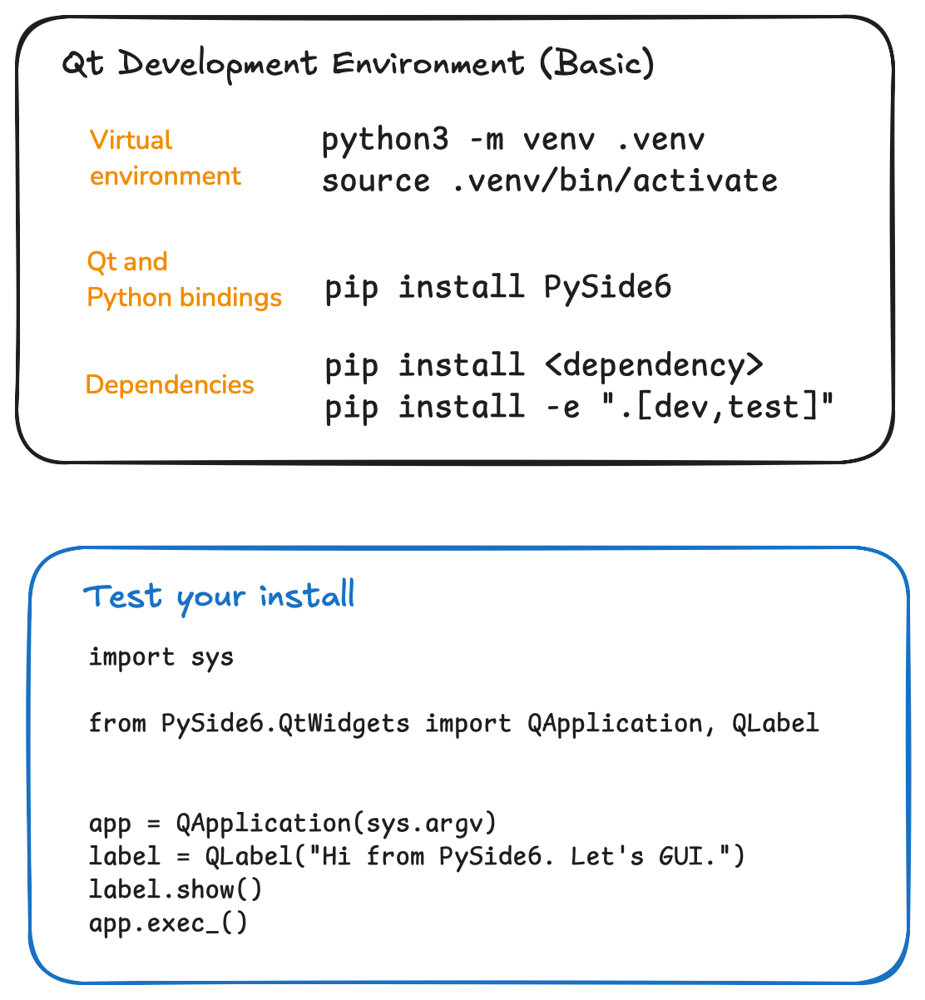

Setting up a basic test of Qt and Python bindings is a good way to ensure that your development environment is working correctly. Here's an example to get you started.

::: {.callout-note}
## Note
You can subsitute `PyQt5` or `PyQt6` for `PySide6` if you prefer
a different set of Python bindings for Qt.
:::

